<div align="center">

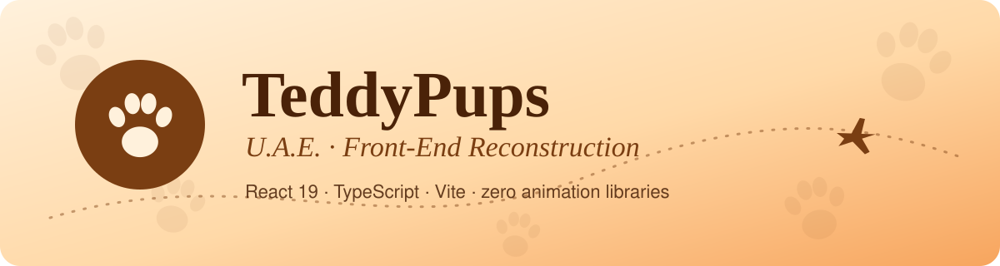

<br />

**A faithful, motion-rich rebuild of a boutique puppy-showroom website.**
A mascot walks the page with you, a plane flies along a dotted route, passport stamps thump into place, and a curtain sweeps between pages — all hand-written, with **no animation library**.

<br />

[](https://puppy-clone-zeta.vercel.app/)
[](https://github.com/Riteshkanara/puppy-clone)
[](./LICENSE)


<br />

**[✨ Highlights](#-highlights)** ·
**[🖼 Screenshots](#-screenshots)** ·
**[🧪 Try it](#-try-it-in-60-seconds)** ·
**[🚀 Quick start](#-quick-start)** ·
**[🧭 Architecture](#-architecture)** ·
**[🎞 Motion system](#-the-motion-system)** ·
**[🛠 How it was built](#-how-it-was-built)** ·
**[📚 Docs](#-documentation)**

<br />

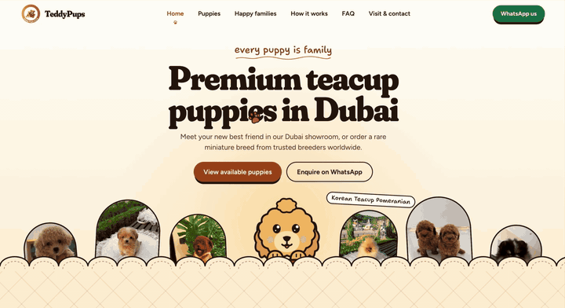

<sub>The mascot, the page curtain and the scroll scenes in action.</sub>

</div>

---

## 📌 Overview

This is a front-end reconstruction of the TeddyPups U.A.E. marketing site. The goal was **fidelity**: layout, typography, colour, copy and, above all, the *motion design*.

> [!NOTE]
> Every effect is hand-written with CSS, SVG, `requestAnimationFrame` and `IntersectionObserver`. `prefers-reduced-motion` is respected throughout.

### At a glance

<table>
  <tr>
    <td align="center" width="25%"><h3>~7.8k</h3><sub>lines of TypeScript / TSX</sub></td>
    <td align="center" width="25%"><h3>~6.5k</h3><sub>lines of plain CSS</sub></td>
    <td align="center" width="25%"><h3>9</h3><sub>routes (8 pages + a 404)</sub></td>
    <td align="center" width="25%"><h3>3</h3><sub>runtime dependencies</sub></td>
  </tr>
  <tr>
    <td align="center"><h3>137</h3><sub>original media files (~68 MB) + 24 "gone home" photos</sub></td>
    <td align="center"><h3>147.70 kB</h3><sub>JS, gzipped (536.76 kB raw)</sub></td>
    <td align="center"><h3>29.52 kB</h3><sub>CSS, gzipped (134.92 kB raw)</sub></td>
    <td align="center"><h3>✔ ✔</h3><sub><code>npm run lint</code> and <code>npm run build</code> pass</sub></td>
  </tr>
</table>

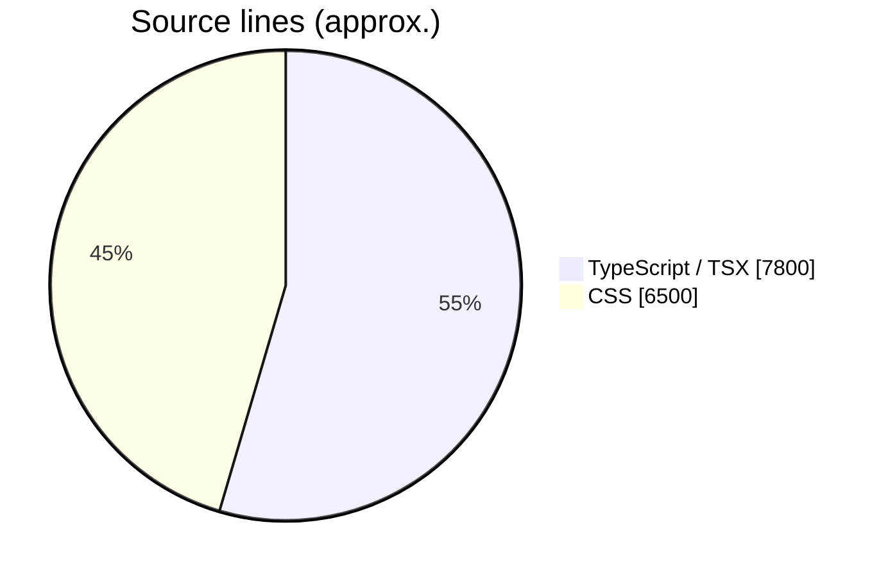

---

## ✨ Highlights

<table>
  <tr>
    <td width="33%" valign="top">
      <h3>🐕 Travelling mascot</h3>
      A rigged SVG puppy follows the reader down <i>and back up</i> the page along one path. Pose, wag, gaze, ear spring, blink and bounce are computed every frame.
    </td>
    <td width="33%" valign="top">
      <h3>🎚 Zero-re-render scroll</h3>
      <code>data-scrub</code> elements get a CSS variable <code>--p</code> from 0 to 1. CSS reads it, so React never re-renders on scroll.
    </td>
    <td width="33%" valign="top">
      <h3>🎭 Page curtain</h3>
      Teddy runs across a curtain on first load, link clicks and back/forward. Reveals wait for the <code>tp:curtain-open</code> event.
    </td>
  </tr>
  <tr>
    <td valign="top">
      <h3>🔎 URL-synced filters</h3>
      Puppy filters live in the query string, so a filtered view can be shared, refreshed and navigated with back/forward.
    </td>
    <td valign="top">
      <h3>🧾 Typed content</h3>
      Content lives in typed data files, so data-shape mistakes fail at <b>build time</b>, not in the browser.
    </td>
    <td valign="top">
      <h3>♿ Reduced motion</h3>
      Scroll scrub, reveal and the page curtain all honour <code>prefers-reduced-motion</code>.
    </td>
  </tr>
  <tr>
    <td valign="top">
      <h3>✈️ Scene library</h3>
      Flight path, passport stamps, door-open and basket scenes on the home page, driven by one shared scroll system.
    </td>
    <td valign="top">
      <h3>🖱 Paw cursor & trail</h3>
      A paw cursor and footprint trail for real mouse pointers only.
    </td>
    <td valign="top">
      <h3>🔤 Self-hosted fonts</h3>
      Fraunces, Figtree and Shantell Sans as <code>woff2</code>. No third-party font requests.
    </td>
  </tr>
</table>

---

## 🖼 Screenshots

<p align="center">
  <br />
  <sub><b>Home</b> · eight scroll scenes from morning to night</sub>
</p>

<table>
  <tr>
    <td width="50%">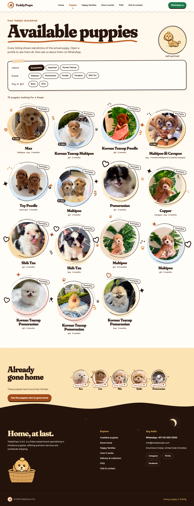<br /><sub><b>Puppies</b> · sketch cards and URL-synced filters</sub></td>
    <td width="50%">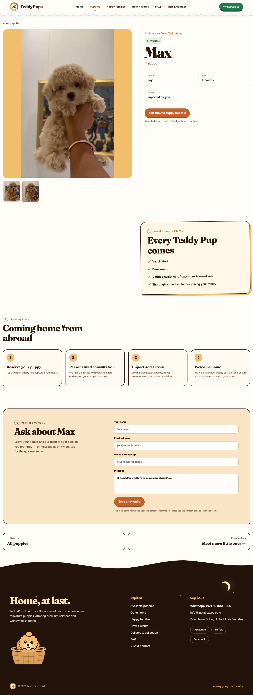<br /><sub><b>Puppy detail</b> · <code>/puppies/:slug</code></sub></td>
  </tr>
  <tr>
    <td width="50%">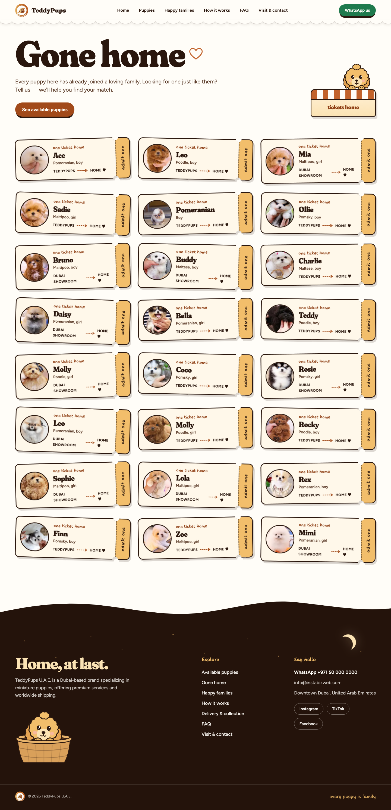<br /><sub><b>Gone home</b> · ticket-style archive</sub></td>
    <td width="50%">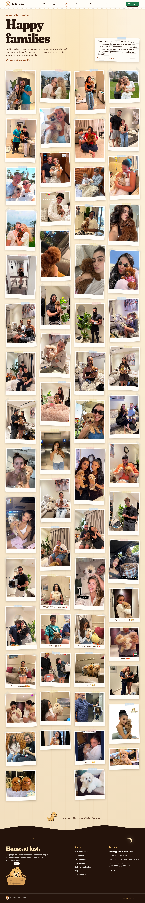<br /><sub><b>Happy families</b> · polaroid wall with full-screen viewer</sub></td>
  </tr>
  <tr>
    <td width="50%">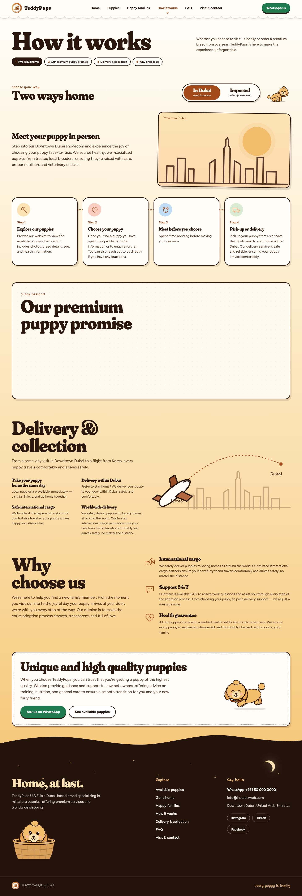<br /><sub><b>How it works</b> · the adoption journey</sub></td>
    <td width="50%">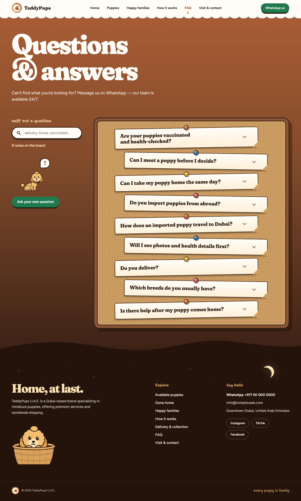<br /><sub><b>FAQ</b> · searchable notice-board accordion</sub></td>
  </tr>
  <tr>
    <td width="50%">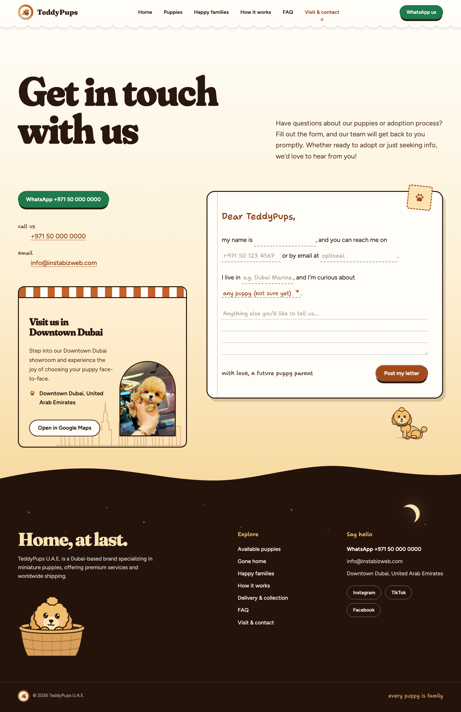<br /><sub><b>Contact</b> · the "Dear TeddyPups" letter form</sub></td>
    <td width="50%">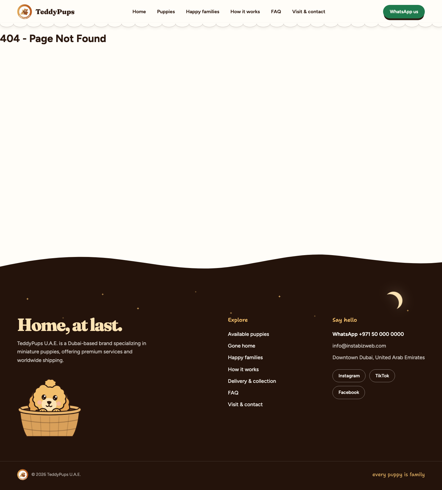<br /><sub><b>404</b> · also used for an unknown puppy slug</sub></td>
  </tr>
</table>

<details>
<summary><b>📱 Mobile layouts</b></summary>
<br />

<table>
  <tr>
    <td align="center"><br /><sub>Home</sub></td>
    <td align="center"><br /><sub>Puppies</sub></td>
    <td align="center">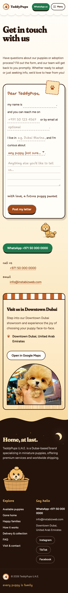<br /><sub>Contact</sub></td>
  </tr>
</table>
</details>

<details>
<summary><b>📸 Regenerate every screenshot</b></summary>
<br />

All images in `docs/screenshots/` come from one script. It waits out the page curtain, scrolls each page so every reveal fires, then saves desktop (1440 px) and mobile (390 px) captures of all 9 routes.

```bash
npm i -D playwright && npx playwright install chromium   # one time
npm run build && npm run preview                          # terminal 1
node scripts/capture-screenshots.mjs                      # terminal 2
```

Point it at the live site instead with `BASE_URL=https://puppy-clone-zeta.vercel.app node scripts/capture-screenshots.mjs`.
</details>

---

## 🧪 Try it in 60 seconds

Open the **[live site](https://puppy-clone-zeta.vercel.app/)** and try these:

- [ ] **Scroll all the way down, then back up.** The mascot retraces the same path.
- [ ] **Click any nav link, then press the browser's back button.** Watch the curtain run both times.
- [ ] **Go to `/puppies`, apply a filter and refresh.** The filter survives, because it lives in the URL.
- [ ] **Move a real mouse around.** Paw cursor and footprint trail (not shown on touch devices).
- [ ] **Open `/happy-families` and click a polaroid** for the full-screen viewer.
- [ ] **Search the `/faq`** notice board.
- [ ] **Visit `/puppies/not-a-real-puppy`** for the custom 404.

---

## 🗺 Pages

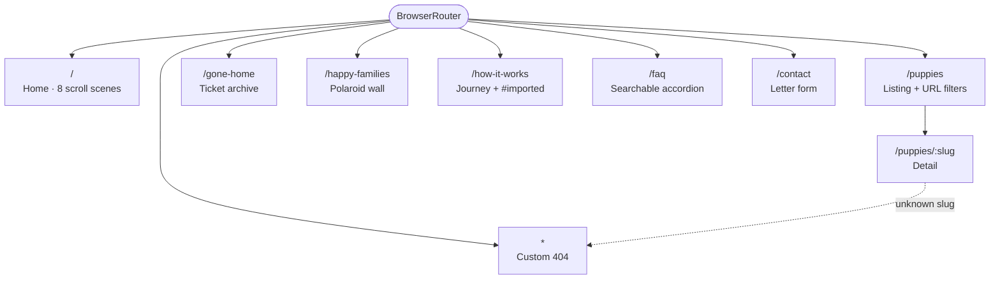

| Route | Page |
|---|---|
| `/` | Home: eight scroll scenes from morning to night |
| `/puppies` | Puppy listing with filters kept in the URL query |
| `/puppies/:slug` | Puppy detail page |
| `/gone-home` | Ticket-style archive of puppies that found homes |
| `/happy-families` | Polaroid wall with a full-screen viewer |
| `/how-it-works` | The adoption journey, with an in-page `#imported` section |
| `/faq` | Searchable accordion driven by a typed data file |
| `/contact` | Showroom card and an animated letter form |
| `*` | Custom 404, also used for an unknown puppy slug |

---

## 🧰 Tech stack

<div align="center">


</div>

| Layer | Choice |
|---|---|
| UI | React 19 |
| Language | TypeScript, with `erasableSyntaxOnly` enabled |
| Build | Vite 8 |
| Routing | React Router 7 |
| Styling | Plain CSS with custom properties, no framework |
| Motion | CSS, SVG, `requestAnimationFrame`, `IntersectionObserver` |
| Linting | ESLint 10 with `typescript-eslint` and the React Hooks plugin |
| Hosting | Vercel (static, with an SPA rewrite) |

---

## 🚀 Quick start

**Prerequisites:** a current Node.js LTS. It was developed on Node 26 and npm 11.

```bash
git clone https://github.com/Riteshkanara/puppy-clone.git
cd puppy-clone
npm install
npm run dev
```

Open the URL Vite prints, normally `http://localhost:5173`.

| Command | What it does |
|---|---|
| `npm run dev` | Dev server with hot reload |
| `npm run build` | Type-check (`tsc -b`) and build to `dist/` |
| `npm run preview` | Serve the production build locally |
| `npm run lint` | Run ESLint |

<details>
<summary><b>Re-fetching reference media (optional)</b></summary>
<br />

The original media is already committed, so this is not needed to run the site. The scripts below show how the reference content was collected:

```bash
node scripts/fetch-media.mjs         # puppy galleries and Happy Families photos
node scripts/fetch-home-media.mjs    # home page photos and videos
node scripts/extract-families.mjs <saved-happy-families.html>
```

They read `docs/reference/*.json` and download only files that are missing locally.
</details>

---

## 🧭 Architecture

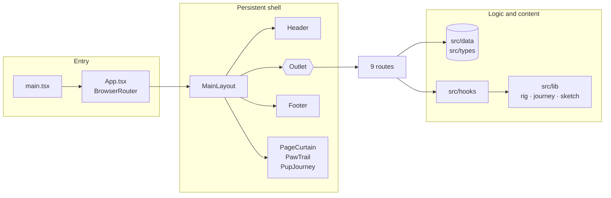

```text
src/
├── components/     UI and motion components
│   ├── home/       Home primitives and the 8 scenes
│   └── contact/    Letter form, showroom card, post scene
├── data/           Typed content: puppies, families, FAQ, contact, home doors, buddies
├── hooks/          Scroll scrub, reveal, flight path, chat steps, media query, document meta
├── layouts/        MainLayout: header, footer, curtain, mascot host
├── lib/            Framework-free logic: mascot rig, actions, journey planner, sketch paths
├── pages/          One component per route
├── styles/         Tokens, typography, buttons, home and motion CSS
└── types/          Shared interfaces
public/             Original media, brand, cursor and Teddy assets
scripts/            Node scripts that fetch and extract reference data, and capture screenshots
docs/               Project documentation, screenshots and extracted reference data
```

| Module | Responsibility |
|---|---|
| `lib/pupRig.ts` | `PupRig` class: poses plus motion state become SVG `transform` and `opacity` values every frame |
| `lib/pupJourney.ts` | Plans the mascot's route and solves its position as a pure function of `scrollY` |
| `components/PageCurtain.tsx` | Route-change curtain with four phases: `cover`, `enter`, `lift`, `idle` |
| `hooks/useScrollScrub.ts` | Scroll position becomes a `--p` CSS variable, with eased interpolation |
| `hooks/useReveal.ts` | Scroll reveal that waits for the curtain gate |
| `hooks/useDocumentMeta.ts` | Per-route title and meta description, with no head-manager library |

The full write-up is in [`docs/ARCHITECTURE.md`](docs/ARCHITECTURE.md).

---

## 🎞 The motion system

Four small systems cooperate to produce every animation. None of them needs an animation library.

### 1 · Scroll scrub: scrolling without re-rendering

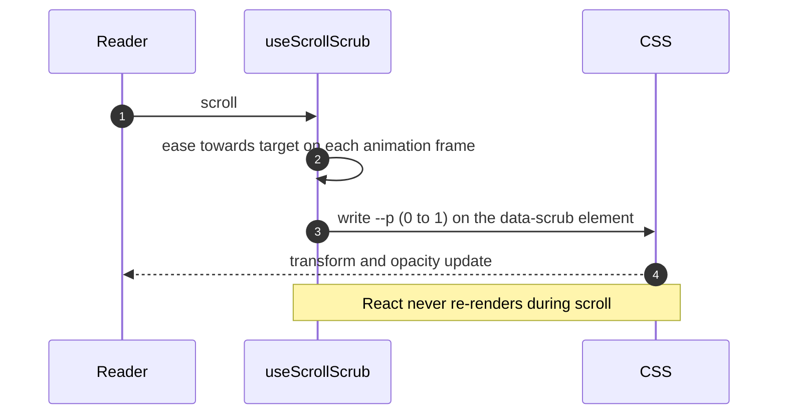

### 2 · Page curtain: four phases

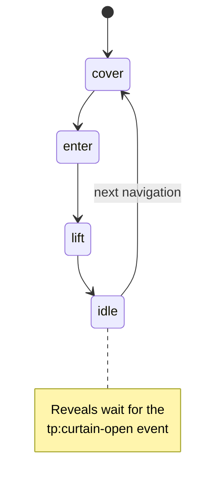

The curtain runs on first load, link clicks and browser back/forward. `useReveal` waits for the `tp:curtain-open` event, so nothing plays hidden behind the curtain.

### 3 · Reveal on scroll

`IntersectionObserver` plus `MutationObserver`, so content added later (for example after a filter change) is revealed too.

### 4 · The travelling mascot

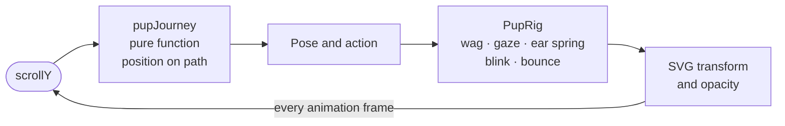

Because the route is solved as a **pure function of `scrollY`**, the mascot walks the same path down and back up the page.

---

## 🛠 How it was built

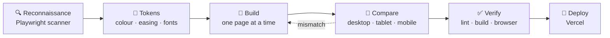

1. **Reconnaissance first.** A Playwright scanner inspected the reference site: 40 pages, 120 screenshots at three widths, links, styles, fonts, interaction tests and 264 downloaded assets.
2. **Evidence-driven build.** Colour tokens, easing curves and fonts were taken from the reference's CSS rather than guessed. Pages were built one at a time and compared against screenshots at desktop, tablet and mobile widths.
3. **AI-assisted, human-verified.** ChatGPT was used for planning, Claude for writing code, Playwright for reconnaissance and a little Gemini. Every command was run by hand, every diff reviewed, and each change checked with lint, build and the browser.
4. **History organised afterwards.** The project was built locally first. This repository's commits and pull requests organise the finished work into reviewable pieces, and their dates are the dates they were created.

---

## ✅ Testing

| Check | Status |
|---|---|
| `npm run lint` | ✅ passes |
| `npm run build` (includes a full TypeScript check) | ✅ passes |
| Manual: home, puppies and filters, puppy detail, invalid puppy URL (404) | ✅ |
| Manual: gone home, happy families, how it works (including `#imported`) | ✅ |
| Manual: page transitions, browser back/forward, refresh on non-home routes | ✅ |
| Manual: mobile layout and original media | ✅ |
| Automated end-to-end tests | ⏳ not yet |
| Lighthouse audit | ⏳ not yet |

---

## 🌍 Deployment

The output of `npm run build` is a static site in `dist/`. Because routing happens in the browser, every path must fall back to `index.html`. This repo includes a `vercel.json` rewrite for that, so refreshing `/puppies` or a puppy page works.

| Host | Setup |
|---|---|
| **Vercel** (used here) | Framework Vite, build `npm run build`, output `dist`, `vercel.json` rewrite included |
| **Netlify** | Build `npm run build`, publish `dist`, add `/* /index.html 200` to `public/_redirects` |

---

## ⚙️ Configuration

Contact details are centralised in `src/data/contactDetails.ts`. The contact letter form supports several delivery modes:

| `delivery.mode` | Behaviour |
|---|---|
| `'whatsapp'` | Opens a pre-filled WhatsApp chat |
| `'email'` | Opens a pre-filled `mailto:` message |
| `'endpoint'` | `POST`s JSON to `delivery.endpoint` |
| `null` | The form renders but sending is disabled |

> [!IMPORTANT]
> The reference site is a template demo, so the contact details shown are its demo content and not a real business's. Replace them before any real use.

Other content: FAQ in `src/data/faq.ts`, puppies in `src/data/puppies.ts`, families in `src/data/families.json`.

---

## 📚 Documentation

| Document | What it covers |
|---|---|
| [Architecture](docs/ARCHITECTURE.md) | Routing, data flow, design system and the animation system |
| [Decisions](docs/DECISIONS.md) | Technical choices, alternatives and trade-offs |
| [Challenges](docs/CHALLENGES.md) | Real problems with symptom, cause, fix and lesson |
| [AI usage](docs/AI-USAGE.md) | Which tools were used, for what, and what I verified |
| [Prompts](docs/PROMPTS.md) | The prompts used |
| [AI workflow](docs/AI-WORKFLOW.md) | How context was carried between AI sessions |
| [Testing](docs/TESTING.md) | Checks performed and gaps |
| [Deployment](docs/DEPLOYMENT.md) | Vercel settings and the SPA rewrite |

---

## 🧩 Development conventions

- TypeScript with `erasableSyntaxOnly`: **no constructor parameter properties or enums.**
- Content goes in `src/data`, logic in `src/lib` or `src/hooks`, never inline in pages.
- No new runtime dependency without a clear reason.
- Run `npm run lint && npm run build` before opening a pull request.

---

## ⚠️ Known limitations

- **One large JS chunk:** 536.76 kB triggers Vite's 500 kB warning. Route-level `React.lazy` code splitting is the planned fix.
- **No automated tests** yet, and no Lighthouse audit.
- **Images are served unoptimised**, as originals.
- **Mascot journey** is not finished across the whole page, and the phone recording scene is not built.
- **Demo contact details** come from the reference site.

## 🗓 Roadmap

- [x] Header, footer, routing and design tokens
- [x] Puppies, detail, gone-home and happy-families pages
- [x] How it works, FAQ and contact pages
- [x] Page curtain, paw trail, flight path, passport stamps, door and basket scenes
- [ ] Route-level code splitting
- [ ] Image optimisation
- [ ] Playwright end-to-end tests
- [ ] Lighthouse and accessibility audit
- [ ] Complete the mascot journey and phone scene

---

## 📄 Disclaimer

This is an **independent, non-commercial reconstruction** made for learning and portfolio purposes. It is not affiliated with or endorsed by TeddyPups U.A.E. or the original site's builder. Brand names, logos, photography, listings and copy belong to their respective owners. If you are a rights holder and want anything removed, please open an issue.

## 🪪 License

Source code is released under the **MIT License**, see [`LICENSE`](./LICENSE). It covers the code only, not third-party brand assets or content.

---

<div align="center">


**Built by [Ritesh Kanara](https://github.com/Riteshkanara)**
B.Tech CSE student and full-stack developer based in Ahmedabad, India.

[](https://puppy-clone-zeta.vercel.app/)

<sub>If this project helped or amused you, a ⭐ on the repo is very welcome.</sub>

</div>