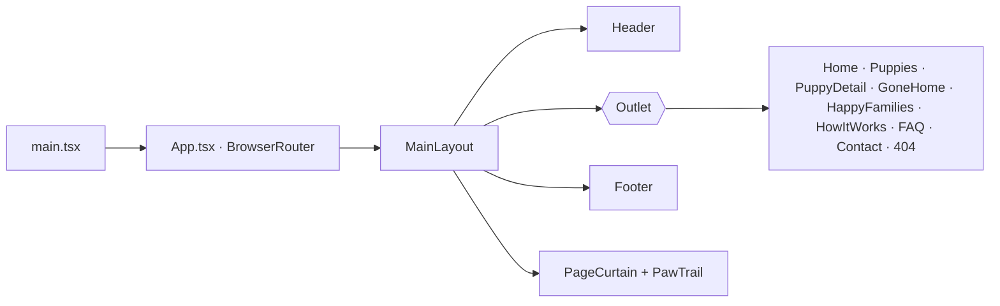
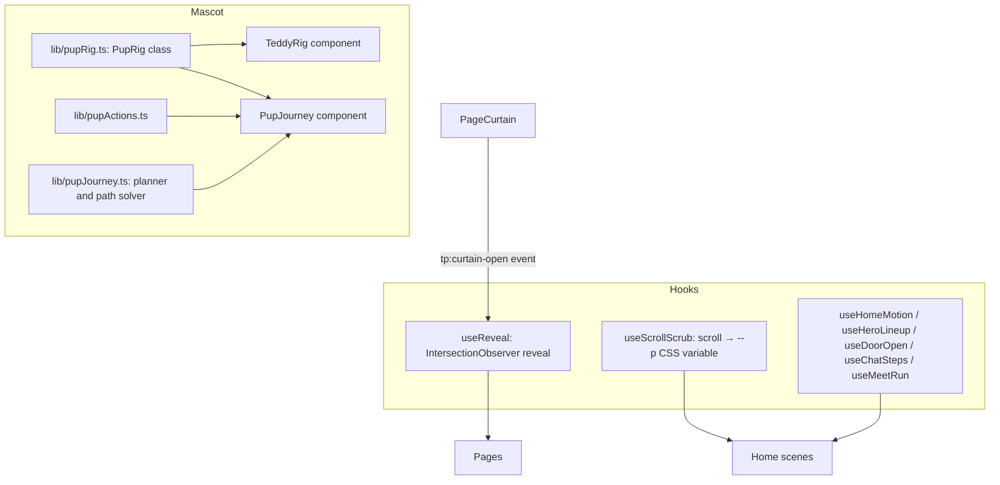

# Architecture

A React 19 + TypeScript single-page app, built with Vite and React Router 7, that reconstructs the
TeddyPups U.A.E. website (reference: https://puppy.instabizweb.com/). There is no backend. Content lives in
typed data files and static media, and the site deploys as static files.

## At a glance
| | |
|---|---|
| Source | ~7.8k lines of TS/TSX, ~6.5k lines of CSS, 120 modules after bundling |
| Routes | 9 (8 pages + 404) |
| Runtime dependencies | 3: `react`, `react-dom`, `react-router-dom` |
| Media | 137 original files (~68 MB) in `public/media`, plus 24 gone-home photos |
| Production build | JS 536.76 kB (147.70 kB gzip), CSS 134.54 kB (29.50 kB gzip) |
| Quality gates | `npm run lint` and `npm run build` (`tsc -b && vite build`) both pass |

The animation, mascot and transition code uses no animation library. It is hand-written TypeScript
and CSS on top of React, driven by `requestAnimationFrame` and `IntersectionObserver`.

## Routing
`App.tsx` renders one `BrowserRouter` with every page nested under `MainLayout` (header, footer, outlet).

| Path | Page |
|---|---|
| `/` | HomePage (8 animated scenes) |
| `/puppies` | PuppiesPage (filterable listing, state kept in the URL query) |
| `/puppies/:slug` | PuppyDetailPage |
| `/gone-home` | GoneHomePage |
| `/happy-families` | HappyFamiliesPage (polaroid wall + full-screen viewer) |
| `/how-it-works` | HowItWorksPage |
| `/faq` | FAQPage |
| `/contact` | ContactPage |
| `*` | NotFoundPage (also used for an unknown puppy slug) |

Because routing is client-side, a refresh on any non-home path needs a host rewrite to `index.html`.
See [DEPLOYMENT.md](DEPLOYMENT.md).

## Folder map
| Path | Responsibility |
|---|---|
| `src/main.tsx`, `App.tsx` | Entry point, global CSS imports, route table |
| `src/layouts/` | `MainLayout`: shared shell around every routed page |
| `src/pages/` | One component per route, plus `pages/puppies/PuppyDetailPage` |
| `src/components/` | Shared UI: Header, Footer, PuppyBrowser, FamilyWall, FamilyViewer, PupJourney, PageCurtain, PawTrail, Teddy and the mascot components |
| `src/components/home/` | Home building blocks (`Clip`, `Door`, `Photo`, `PupBuddy`) and `scenes/` (Hero, Meet, Paths, Chat, Passport, Dusk, Night, HomeCta) |
| `src/components/contact/` | `LetterForm`, `ShowroomCard`, `PostScene`, `ContactPup` |
| `src/hooks/` | Behaviour: scroll reveal, scroll scrub, flight path, chat steps, hero lineup, door open, media query, document meta |
| `src/lib/` | Framework-free logic: mascot rig and actions, journey planner, sketch generator, paw trail, polaroid layout, letter helper, puppy filter options |
| `src/data/` | Typed content: puppies, families, FAQ, contact details, home doors, buddies |
| `src/types/` | Shared interfaces (`puppy.ts`, `family.ts`) |
| `src/styles/` | Design tokens, typography, buttons, home and motion CSS |
| `public/` | Original media, brand, cursor and Teddy assets, gone-home photos |
| `scripts/` | Node scripts that fetch and extract reference media and data |
| `docs/reference/` | Extracted reference data (JSON) |

## Data flow
Typed data in `src/data` feeds pages, and pages compose components. Interfaces in `src/types` are the
contract between them, so a data shape mismatch fails at `tsc -b` rather than in the browser.
The `/puppies` filters (`?origin=&breed=&gender=&collection=`) are synced to the URL, so filtered views
can be linked and survive a refresh. Puppy card illustrations are generated deterministically from each
slug by `lib/sketch.ts`.

## Design system
- `styles/tokens.css`: colours (cocoa, toffee, honey, milk, and so on), spacing and easing curves.
- `styles/typography.css`: three self-hosted variable fonts (Fraunces, Figtree, Shantell Sans) as woff2 files.
- `styles/buttons.css`: shared button variants.
- Each component and page has its own CSS file next to it. Home-only rules are in `styles/home.css`.

## Animation system
The animations are built in layers, from low-level hooks up to whole-page effects.

**Scroll scrub (`useScrollScrub`).** Elements marked `data-scrub` get a CSS variable `--p` from 0 to 1 that
follows their position in the viewport in both scroll directions. A `requestAnimationFrame` loop eases the
value toward its target (smoothing factor 0.16), and `data-scrub-i` staggers siblings. CSS reads `--p`, so React
does not re-render on scroll. With `prefers-reduced-motion`, every element is set to `--p: 1` and no loop runs.

**Reveal (`useReveal`).** Elements marked `data-reveal` get armed and revealed with an `IntersectionObserver`.
Elements already on screen at mount are revealed immediately to avoid a flash, and a `MutationObserver`
picks up elements added later, such as after a filter change. Reduced motion reveals everything at once.

**Page curtain (`PageCurtain`).** Teddy runs across a sweeping curtain on every page entry. It has four
phases (`cover`, `enter`, `lift`, `idle`) and handles three cases:
1. First load or refresh: it covers, waits for fonts and the load event (700 ms minimum, 2.2 s maximum), then lifts.
2. In-app link click: a capture-phase click handler intercepts same-origin links, runs the curtain, navigates
   behind it, then lifts.
3. Back/forward: a `useLayoutEffect` covers the new route before its first paint.

While the curtain is up, `<html data-curtain="on">` pauses the hero animations and the reveal scan.
Both start on the `tp:curtain-open` event, so nothing plays hidden behind the curtain. Only a pathname change
triggers it, so filtering `/puppies` does not. Scroll is locked while it is up, and reduced-motion visitors never see it.

**Mascot rig (`lib/pupRig.ts`).** `PupRig` is a class that drives the Teddy SVG every animation frame. It
binds `[data-p]` parts to computed `transform` and `opacity` values from a named pose (`stand`, `sit`, `lie`,
`bow`, `beg` and others) plus motion state: stride, wag, gaze, blink, ear spring and a damped bounce
spring. It writes an attribute only when the value changed. The same rig powers the page curtain, the home
Meet scene and the scroll-driven journey.

**Mascot journey (`PupJourney`, `lib/pupJourney.ts`).** Teddy's position is a pure function of `scrollY`:
scrolling down walks the path and scrolling up walks it back. Stops come from `[data-pup-stop]`
attributes in the page markup. The journey is skipped for reduced motion and when fewer than two stops exist.

## Home page
`HomePage` composes eight scenes in order, each wrapped in a `data-section` named after the original:
hero, meet, paths, journey (chat), trust (passport), families (dusk), questions (night), cta.

## Accessibility and motion
Reduced-motion branches exist in `useScrollScrub`, `useReveal` and `PageCurtain`. `PageCurtain` is
`aria-hidden`. Pages set `<title>` and meta description through `useDocumentMeta`, with no head-manager library.

## Build and tooling
Vite 8, TypeScript ~6.0, ESLint 10 with `typescript-eslint` and the React Hooks plugin. `npm run build`
type-checks with `tsc -b` and then bundles. The build emits one 536 kB JS chunk, which triggers Vite's
500 kB warning. Route-level code splitting with `React.lazy` is the planned fix.